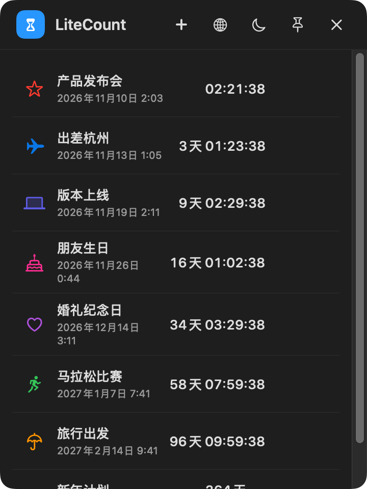
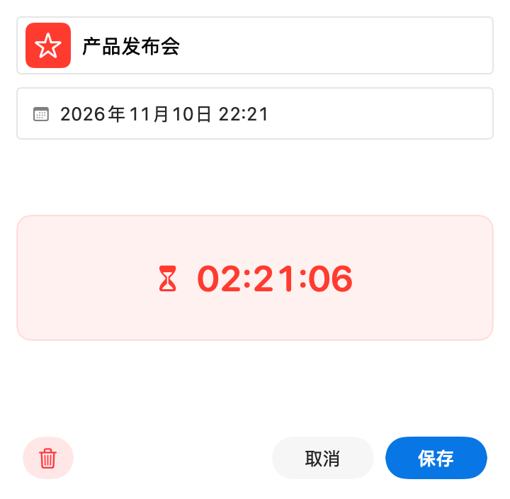
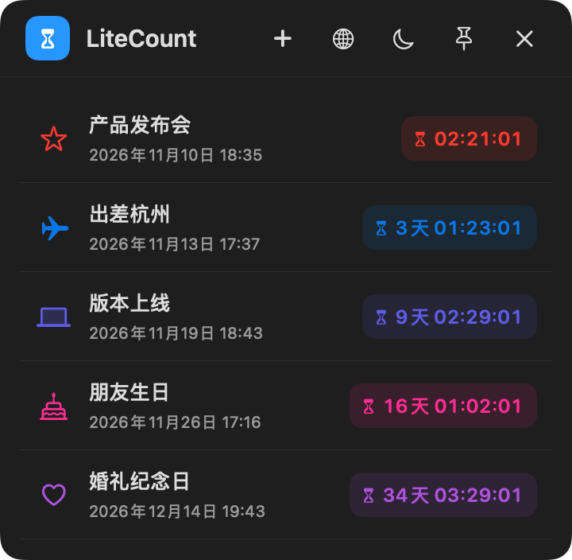
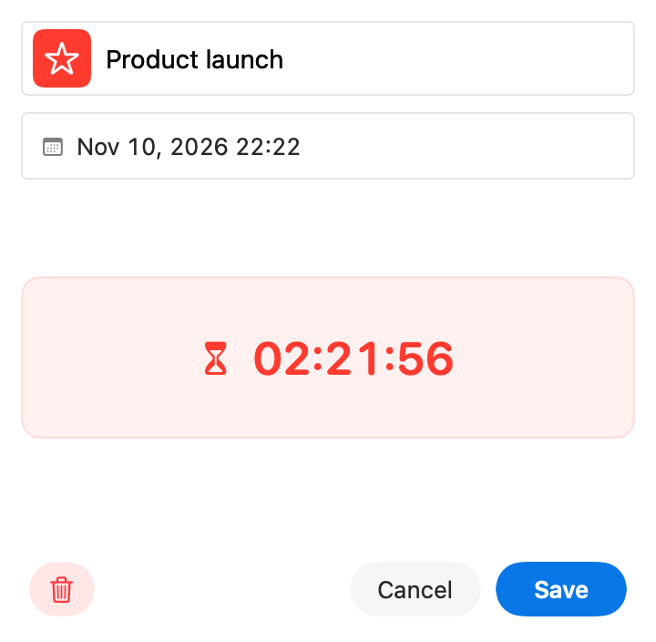

<div align="center">

# LiteCount

**轻量桌面倒计时 · A lightweight desktop countdown for macOS**

随时看到重要时刻还有多远。Keep the distance to your important moments visible.

</div>

---

LiteCount 是一款原生 macOS 轻量倒计时工具。设置「事项名称 + 目标时间」，应用自动计算并实时显示剩余**天、时、分、秒**。

LiteCount is a native macOS countdown tool. Set a name and a target time, and it live-displays the remaining **days, hours, minutes, and seconds**.

## 特性 / Features

- **桌面悬浮球** / **Floating ball** — 蓝色沙漏悬浮球常驻屏幕边缘，角标显示进行中事项数；悬停展开列表，收起、拖动、定位与同系列一致。
  A blue hourglass ball lives at the screen edge with an upcoming-item badge; hover to unfold the list.
- **实时倒计时** / **Live countdown** — 每行展示图标 + 名称 + 目标时间 + 剩余天时分秒，每秒刷新；到期后自动移入右上角「已过期」。
  Each row shows icon, name, target time and remaining time, refreshed every second. Items move to Expired automatically at the target time.
- **紧凑列表** / **Compact list** — 默认可见约五条事项，更多事项可滚动；倒计时颜色跟随事项图标。双击事项编辑，右键菜单可编辑或删除。
  About five items fit by default, with scrolling for more. Countdown colors follow item icons. Double-click to edit, or use the context menu to edit or delete.
- **自动管理** / **Automatic** — 创建即倒计时；按目标时间由近至远排序；重启后自动恢复并重新计算。
  Countdowns start on creation, sort near-to-far, and survive restarts.
- **合并式时间选择** / **Combined picker** — 日历与时/分在同一浮层选择，选完即存；格式跟随应用语言。
  A single sheet combines a month calendar with hour/minute columns.
- **紧凑编辑** / **Compact editing** — 新增与编辑面板和列表等尺寸；从名称框左侧选择图标与颜色，目标时间下方直接显示实时倒计时；切换语言保留未保存草稿。
  New and edit panels match the list size. Pick an icon and color from the name field, see a live countdown below the target time, and keep unsaved changes when switching languages.
- **时间格式** / **Time format** — 中文界面沿用本地化日期时间，英文界面使用与选择器一致的 24 小时制。
  Chinese keeps its localized date and time; English uses the picker's 24-hour clock.
- **个性化** / **Personalization** — 上百个系统图标 × 十种精选配色；浅色/深色模式；中/英文界面。
  100+ system icons, 10 curated colors, light/dark modes, Chinese/English UI.

## 截图 / Screenshots

| 浅色面板 / Light | 编辑器 / Editor |
|---|---|
|  |  |
| **深色面板 / Dark** | **英文编辑器 / English editor** |
|  |  |

## 安装 / Install

1. 从 [Releases](https://github.com/victor-zhang-2026/LiteCount/releases/latest) 下载最新 `LiteCount-<版本>-macOS-arm64.zip` 与 `SHA256SUMS`。
   Download the ZIP and `SHA256SUMS` from Releases.
2. 校验：`shasum -a 256 -c SHA256SUMS`（在下载目录执行）。Verify the checksum.
3. 解压并将 `LiteCount.app` 拖入「应用程序」，首次打开需右键 →「打开」（ad-hoc 签名、未公证）。
   Unzip, move to /Applications, and right-click → Open on first launch (ad-hoc signature, not notarized).

系统要求 / Requires: **macOS 14+ · Apple Silicon**

## 隐私 / Privacy

完全本地运行：无账户、无网络、无遥测、无提醒权限。数据以 JSON 存储于 `~/Library/Application Support/LiteCount/`。详见 [docs/privacy.md](docs/privacy.md)。

Fully local: no accounts, no networking, no telemetry, no notification permissions. Data is stored as JSON in your Application Support directory. See [docs/privacy.md](docs/privacy.md).

## 构建 / Build

```bash
swift build --sdk /Library/Developer/CommandLineTools/SDKs/MacOSX26.5.sdk
# 或 / or
LITECOUNT_MACOS_SDK=/path/to/sdk ./scripts/build-app.sh   # → build/LiteCount.app
```

> 本项目开发机仅含 Command Line Tools，其默认 SDK 缺少 SwiftUI 宏插件，构建需显式指定包含该插件的 SDK；安装完整 Xcode 后可直接 `swift build`。
> The dev machine's CLT default SDK lacks the SwiftUI macro plugin, so an explicit SDK is required; with full Xcode installed, plain `swift build` works.

## 系列产品 / Series

LiteCount 与 [LiteTick](https://github.com/victor-zhang-2026/litetick)、[LiteCal](https://github.com/victor-zhang-2026/LiteCal) 同属轻量桌面工具系列，共享悬浮球交互与设计语言。

LiteCount is part of a series of small desktop tools alongside LiteTick and LiteCal, sharing the floating-ball interaction language.

## 许可 / License

[MIT](LICENSE)
